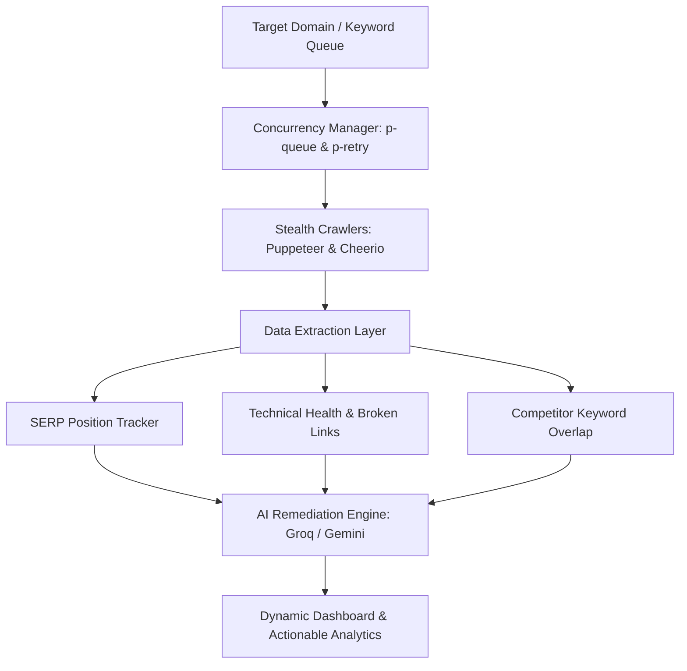

<div align="center">

# 🚀 RANKRUSH // SERP TELEMETRY
### Real-Time SEO Intelligence, Distributed Web Auditing & Competitive Search Telemetry

[](https://opensource.org/licenses/MIT)
[](https://github.com/robat699-cmyk/Rankrush)
[](https://github.com/robat699-cmyk/Rankrush)
[](https://github.com/robat699-cmyk/Rankrush)
[](https://github.com/robat699-cmyk/Rankrush)

<br/>

> **"A high-throughput, open-architecture alternative to Semrush & Ahrefs — combining headless browser automation with generative AI on-page diagnostic playbooks."**

</div>

---

## 🏗️ Architecture & Pipeline Flow



---

## ⚡ Core Engine Features

### 🔍 Automated SERP Position Tracking
- Real-time ranking verification across targeted locales with historical position volatility markers and fluctuation delta tracking.

### 🛠️ Deep Technical Audits
- Automated page crawler diagnosing **Canonical loops**, **Core Web Vitals bottlenecks**, **robots.txt / sitemap mismatches**, and **missing OpenGraph/JSON-LD schemas**.

### ⚔️ Competitor Domain Gap Analysis
- Multi-domain matrix comparing cross-domain footprints to uncover untapped organic traffic opportunities and high-intent keyword targets.

### 🧠 AI Optimization Recommendations
- Seamless integration with Google GenAI and Groq SDK generating automated title tag fixes, semantic content structure blueprints, and schema snippets.

---

## 💻 Tech Stack Specification

| Component | Technology |
|---|---|
| **Runtime & Core** | TypeScript, Node.js, Express, tsx |
| **Extraction Engine** | Puppeteer Extra, Stealth Plugin, Cheerio, Axios |
| **Concurrency Control** | `p-queue` rate limiting, `p-retry` exponential backoff |
| **AI Intelligence** | Google GenAI (@google/genai), Groq SDK |
| **Frontend UI** | React, TypeScript, Tailwind CSS, Lucide Icons, Framer Motion |

---

## 🚀 Quickstart & Setup

```bash
# 1. Clone the repository
git clone https://github.com/robat699-cmyk/Rankrush.git
cd Rankrush

# 2. Install dependencies
npm install

# 3. Environment configuration
cp .env.example .env
# Set GEMINI_API_KEY, GROQ_API_KEY, and PORT

# 4. Run the fullstack service
npm run dev
```

---

<div align="center">
  <sub>Developed by <a href="https://github.com/robat699-cmyk">It's TAWHIDUR (@robat699-cmyk)</a></sub>
</div>
